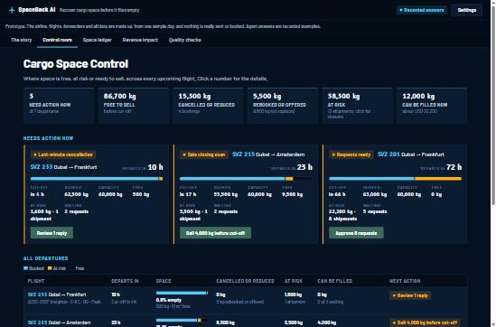
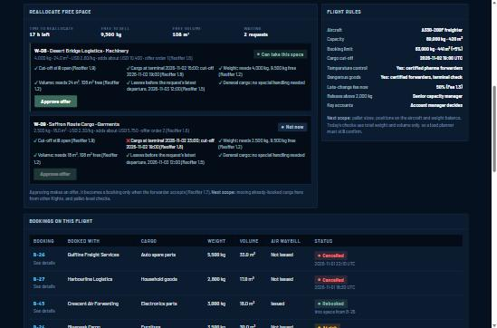

# SpaceBack AI

**Every week, cargo space is booked, then flies empty. SpaceBack helps your capacity team get it back before cut-off.**

An AI agent prototype for airline cargo teams. It shows what changed on every upcoming flight, reads forwarder replies, and helps a person resell freed space, with human approval at every step.

**[Try it, no login needed](https://shreebyravi.github.io/spaceback/)** | **[One-page pitch](docs/PITCH.md)** | **Status:** prototype with made-up data

## The problem

Forwarders book space, then cancel late, send less than they booked, or never show up. An [AGIFORS abstract](https://www.agifors.org/Technical-presentations), on work developed with the Etihad Cargo team, reports **15-30% no-shows and cancellations** between three days before departure and departure, as a network average.

Airlines and vendors can already predict which bookings may not show. Fees recover some money, but they don't fill the aircraft. Our hypothesis is that the follow-through is the gap: asking the forwarder, reading the reply, releasing the space and reselling it in time.

## What it does

| Step | What happens | Who decides |
|---|---|---|
| **See** | A dashboard ranks flights by what can still be saved, and explains why each shipment is at risk | Automatic |
| **Ask** | Reconfirmation requests are prepared at 72 hours | A person approves |
| **Read** | The agent reads each reply, in free text, and proposes keep, reduce, release, chase or escalate | A person approves |
| **Resell** | Freed space is checked against waiting requests, including cut-off | A person approves |
| **Track** | The Space Ledger shows what was cancelled, reallocated and still available, with a revenue estimate | Automatic |

## Why it can be trusted with this job

- **Code handles what must be exact:** space, fees and rule checks.
- **AI handles what needs reading:** free-text replies and draft messages.
- **People decide what has consequences:** every message, release and offer.
- **Limits are enforced twice.** In one of three runs of a stress test, the agent wrongly proposed a 3,200 kg release. The app's own rule blocks approval of that answer.

## AI product decisions

What should AI do and what should code do? How much freedom should the agent get? How do you handle answers that vary? This project's [AI product decisions](docs/AI_PRODUCT_DECISIONS.md) covers those choices, their trade-offs, what a real implementation would add, and my role.

## How it was tested

- **Six eval cases**, with expected results written first. All six matched in the latest run, with 6 Pass verdicts from a person.
- **Two documented improvements**, each driven by a test result.
- **Six stress tests**, including a trick message, a fake approval and a reply in Arabic. All six behaved as expected in the latest run, but one varied across runs, as described above.

The answers shown are recorded examples from a separate Claude Sonnet session, because no API credit was available. A full live run hasn't been done. Details are in [docs/EVALS.md](docs/EVALS.md).

## Known limits

- No airline has tested it, and all operating data is made up.
- It isn't connected to any real system, and it isn't real-time.
- It doesn't check pallets, aircraft positions, weight balance, chargeable weight, allotments, connections, security or customs.
- Revenue figures are rough estimates.
- The product gap is a hypothesis. See the [market scan](docs/MARKET_SCAN.md).

## What's next

1. **Validate:** talk to capacity controllers and test the workflow assumptions.
2. **Pilot on one route:** shadow mode first, then assisted. See the [pilot plan](docs/PILOT_AND_MONITORING.md).
3. **Make it plannable:** pallets, chargeable weight, flight moves and a permanent audit trail. See the [roadmap](docs/ROADMAP.md).

**Interested in testing this on one route?** [Connect with Shree Byravi on LinkedIn](https://www.linkedin.com/in/shree-byravi/).

## What's in this repo

| Path | Contents |
|---|---|
| `index.html` | The whole app, in one file |
| [`docs/`](docs/README.md) | PRD, architecture, decisions, risks, evals, pilot plan and more |
| `data/` | Made-up flights, bookings, forwarders and recorded answers |
| `policies/` | Fictional rules the agent follows |
| `design/` | Notes on the look and feel |

## Run it yourself

Open `index.html` in Chrome or Edge. It runs on recorded answers. To run it live, add your own Anthropic API key in Settings; the key is saved only in your browser.

## Data, privacy and licence

All data is synthetic. Airline and forwarder names are made up, and any resemblance is accidental. No keys or personal data are stored here.

**Created by Shree Byravi.** Product decisions, evaluation and the pilot plan are Shree Byravi's work. The prototype was built with an AI coding assistant, working from those decisions. See also [ScreenGate](https://github.com/shreebyravi/screengate).

Licensed under [CC BY-NC-ND 4.0](LICENSE).
