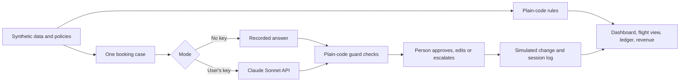
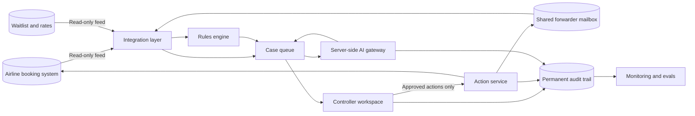

# CargoFlow: Architecture

How the prototype is built today, and how a production version could work. The production design is a proposal for discussion. It has not been built, and it would change once an airline's systems are known.

## The principle

**Code handles what must be exact. AI handles what needs reading. People decide what has consequences.**

| Part | Handled by | Why |
|---|---|---|
| Space, risk signals, fees, rule checks, matching | Plain code | Must be exact, repeatable and easy to audit |
| Reading replies, drafting follow-ups, explaining a proposal | AI agent | Free text needs judgement |
| Sending, releasing, offering | A person | Affects customers and money |

## Today: the prototype

A single `index.html` file with no backend or build step. Without an API key, it replays recorded answers, so anyone can try it. With a key, it calls the model directly from the browser.

| Layer | Today |
|---|---|
| Interface | Vanilla HTML, CSS and JavaScript in one file |
| Data | CSV and policy files in this repo, embedded in the page |
| Model | Anthropic Messages API, `claude-sonnet-5-5`, structured JSON output |
| API key | Saved only in the visitor's browser. Never stored in this repo |
| State | In the browser for the session. Quality-check verdicts in local storage |
| Actions | Simulated. Nothing is sent, booked or changed |

### One case, step by step

1. Plain code works out the flight's space and the booking's risk signals.
2. The app builds one case: flight, booking, forwarder, signals, message thread and policies.
3. The agent returns a structured proposal: status, what the forwarder said, release, message and reasons with sources.
4. Plain code checks the proposal. A release can't exceed the booking, status must match the release, key accounts and releases above 2,000 kg must escalate, and messages can't state fees.
5. Citations are checked against real records and rule sections.
6. A person approves, edits or escalates. Flagged or escalated proposals can't be approved.

## Proposed: a production version

| Component | Purpose | Key question for the airline |
|---|---|---|
| Integration layer | Takes in booking, flight, waitlist and mailbox data | Which system holds this data, and which standards does it use? (for example Cargo-XML or IATA ONE Record) |
| Rules engine | Runs the airline's own rules on every change | Who owns the rules, and how are they changed? |
| Case queue | Holds prepared requests and proposals | Who works it on each shift? |
| AI gateway | Keeps keys on the server, removes data not needed, logs calls and handles failures | Which models and regions are approved? |
| Controller workspace | The interface in this prototype, with real sign-in and roles | Which single sign-on and roles apply? |
| Action service | The only part able to change anything, and only after approval | Which actions may be written back to which system? |
| Audit trail | Records who approved what, when, and from which evidence | What retention rules apply? |
| Monitoring and evals | Tracks quality and re-runs test cases | Who reviews it, and how often? |

## Rollout path

| Stage | Reads | Writes | Purpose |
|---|---|---|---|
| Shadow | Live data | Nothing | Compare proposals with people's real decisions |
| Assisted | Live data | Messages and changes, after approval | Measure time saved and space recovered |
| Wider use | Live data | As agreed | Add routes. Consider limited automation only if the evidence supports it |

## If the AI fails

The rules, dashboard and manual process must keep working without the AI. A failed or unclear answer becomes a case for a person, never an automatic action. The prototype already blocks approval when an answer doesn't match the expected format.

## Not designed yet

Pallet and position checks, chargeable weight, allotments, connecting cargo, multiple languages at scale, and sizing for peak volumes. See [ROADMAP.md](ROADMAP.md).
